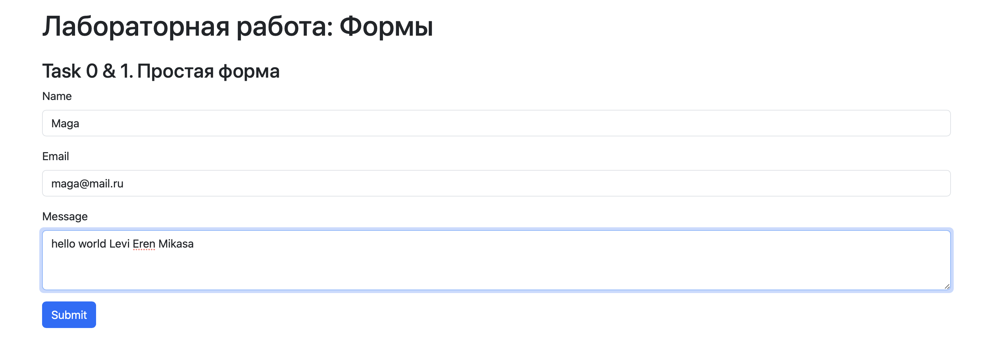
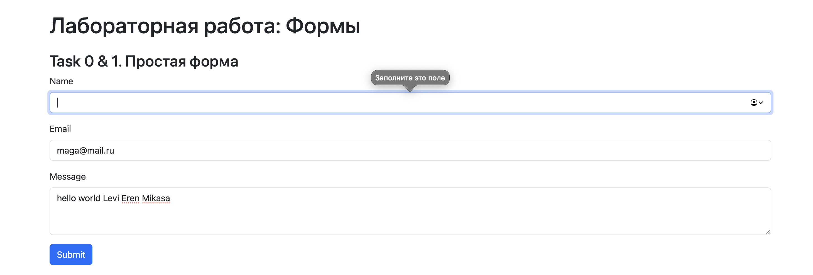
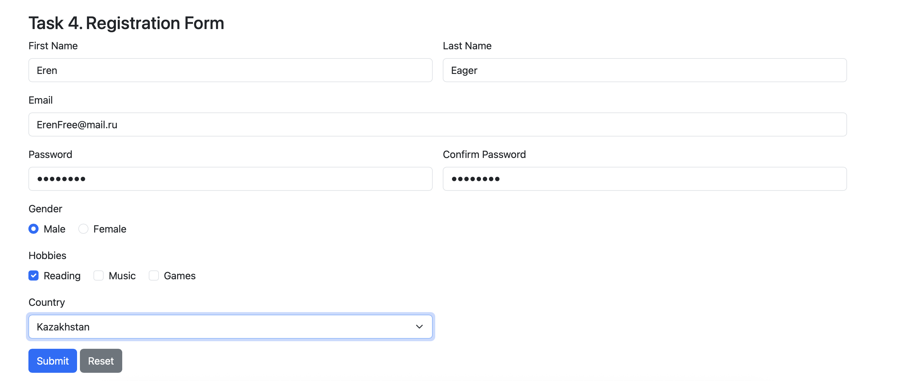

# Assignment: HTML and Bootstrap Forms

**Name:** Seitkapar Magzhan  
**Group:** IT-2501  
**Subject:** Web Technologies

## Description

In this assignment, I created different forms using HTML and Bootstrap.
I used HTML5 validation to check user input and Bootstrap to make the forms look better.

The project contains 5 tasks divided into 3 parts.

## Part 1. Basic HTML Forms

### Task 0. Simple Contact Form

I created a simple contact form using HTML.

The form has:
- Name input
- Email input
- Message textarea
- Submit button

I also used labels for each input field.

### Task 1. HTML5 Validation

I added HTML5 validation to the contact form.

I used:
- required - makes the field required
- type="email" - checks email format
- maxlength="200" - limits the message to 200 characters

The browser checks the fields when the user clicks Submit.

### Screenshot - Task 0 & Task 1

## Part 2. Bootstrap Forms

### Task 2. Bootstrap Form Styling

I created another contact form using Bootstrap.

I used:
- form-control for input fields
- form-label for labels
- row and col-md-6 for layout
- btn btn-primary for the Submit button

Bootstrap helps make the form responsive.

### Task 3. Bootstrap Validation

I added Bootstrap validation to the form.

I used:
- needs-validation
- valid-feedback
- invalid-feedback
- was-validated

I also used JavaScript to check the form when the Submit button is clicked.

If the input is empty or incorrect, the form shows an error message.

If the input is correct, it shows a success message.

### Screenshot - Task 2 & Task 3

## Part 3. Advanced Form Project

### Task 4. Registration Form

I created a registration form using HTML and Bootstrap.
The form includes First Name; Last Name;Email;Password; Confirm Password; Gender or radio button; Hobbies(checkboxes); Country (dropdown list)
; Submit button
; Reset button

I used Bootstrap Grid to arrange the fields.

I also added validation:
- Required fields cannot be empty
- Email must have a valid format
- Password must contain at least 6 characters
- Country must be selected

The Reset button clears the form.

### Screenshot - Task 4

## Work Process

First, I created a simple HTML contact form with input fields and labels.

Then I added HTML5 validation using required, type and maxlength.

After that, I used Bootstrap classes to style the second contact form and make it responsive.

Next, I added validation messages using Bootstrap and JavaScript.

Finally, I created a registration form with different input types, validation and Submit and Reset buttons.

I tested the forms in my browser.

## Conclusion

In this assignment, I learned how to create HTML forms, use different input types and add validation.

I also learned how to use Bootstrap to style forms and make them responsive.