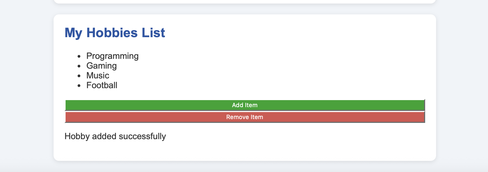
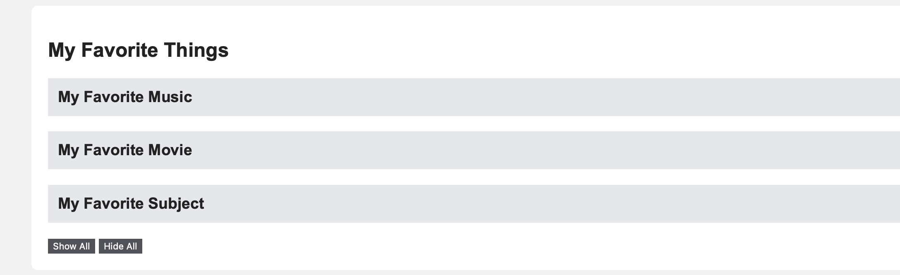
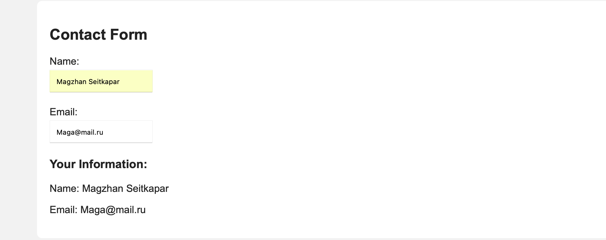
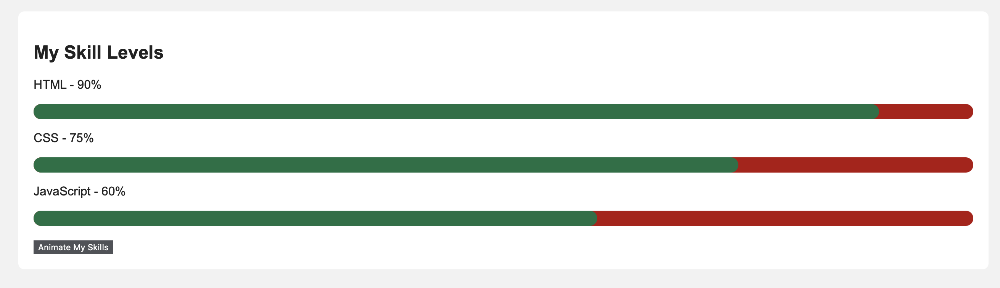

# Assignment #6 – jQuery 

Name: Seitkapar Magzhan
Group: IT-2501
Subject: Web Technologies

## About My Project

In this assignment, I created a simple personal portfolio website using HTML, CSS, and jQuery.I am still learning jQuery, so I tried to keep my code simple and easy to understand.My website has information about me, my skills, photos, social media, and a contact form

Task 0 – My Portfolio
I created my portfolio with my name and some information about myself. I also used different jQuery selectors

Task 1 – About Me
I added a small section about myself and buttons to hide, show, and toggle information

Task 2 – My Gallery
I added two pictures and buttons to show and hide them with fade effects.

Task 3 – jQuery Effects
I used Hide, Show, Toggle, Fade In, Fade Out, and Fade Toggle.

Task 4 – Sliding Effects
I created three sections with information. I used Slide Up, Slide Down, and Slide Toggle.

Task 5 – My Technical Skills
I created a list of my skills. I can add a new skill, put it at the beginning, or remove a skill.

Task 6 – Social Media
I added a GitHub link and a button to change the link.

Task 7 – Contact Form
I created a simple form with Name and Email fields. The information appears on the page.

Task 8 – Skill Animation
I created three skill bars for HTML, CSS, and JavaScript. When I click the button, the bars move to their percentages.

### Technologies Used

* HTML-to create the website structure
* CSS-to make the website look better
* JavaScript-to add basic functionality
* jQuery- to make buttons and effects work

## Summary

While doing this assignment, I learned how to use jQuery selectors, click events, CSS changes, hide and show effects, fade effects, sliding effects, and animations.I also learned how to work with HTML elements using jQuery.This assignment helped me understand jQuery better
