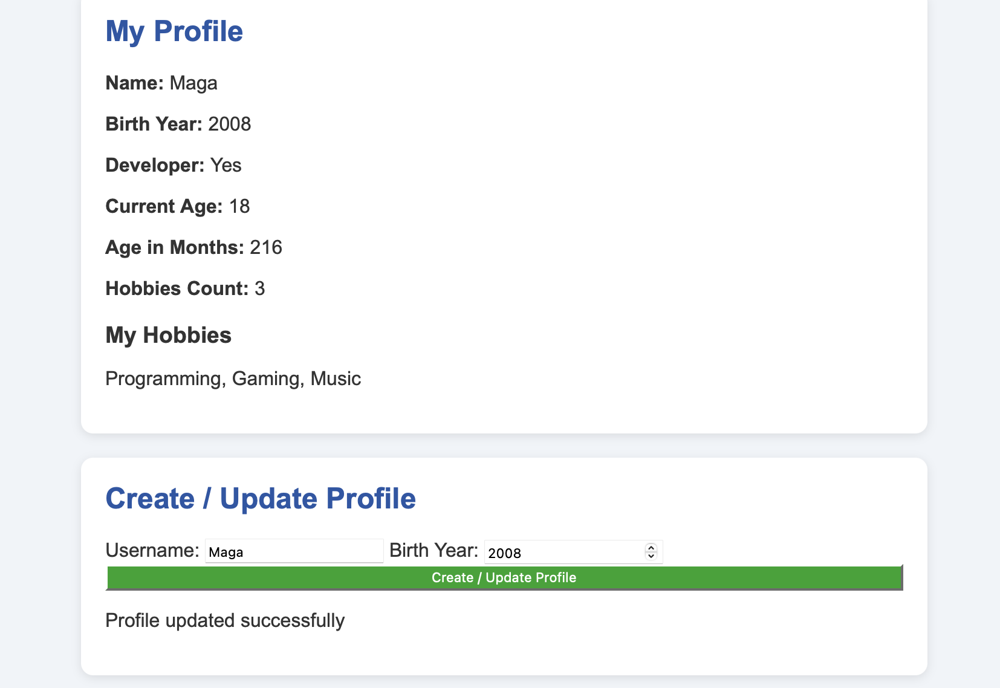
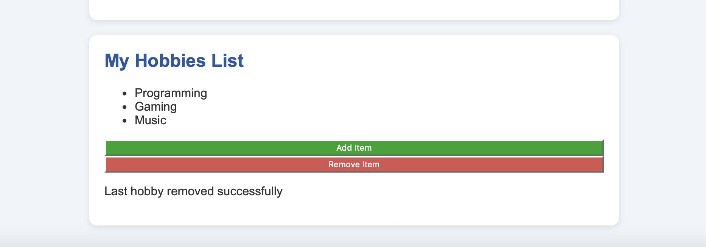

Assignment-5 from Maga

Name: Seitkapar Magzhan
Group: IT-2501
Subject: Web Technologies

About My Project
In this assignment, I created a simple personal profile website using HTML, CSS, and JavaScript.The website shows my profile information, calculates my age, and allows me to update my profile. I also added buttons to add and remove hobbies from a list. I tried to keep the code simple because I am still learning JavaScript
Part 1: Profile Object, Data Types and Arithmetic
Task 1: Personal Info Object
I created a JavaScript object called userProfile. It contains my name, birth year, developer status, and hobbies
I used four data types:
* String – my name
* Number – my birth year
* Boolean – my developer status
* Array – my hobbies

Task 2: Arithmetic Calculations
I used JavaScript to calculate my age based on the current year and my birth year.And also calculated my age in months and the total number of hobbies in my array.After that i used arithmetic operators and the .length property to get these values

Part 2: Form Input and Event Responses
Task 3: HTML Form Setup
I created a form with two input fields:
* Username
* Birth Year

I also added a button called Create / Update Profile

Task 4: Event Listener
I used addEventListener() to handle the form submission.When the user enters a name and birth year and clicks the button, JavaScript updates the userProfile object and displays the new information on the page
I also added simple validation to check the entered values

Part 3: DOM List Manipulation

Task 5: Creating and Removing Elements

I created a hobbies list using HTML <ul> and <li> elements
I added two buttons:

* Add Item – adds a new hobby to the list
* Remove Item – removes the last hobby from the list

I used document.createElement() and appendChild() to add new elements. I used remove() to delete an element
The hobbies array and the list are updated together, so the hobbies count changes automatically

** Summary
While working on this assignment, I learned how to create objects and use different data types in JavaScript.I practiced arithmetic calculations, HTML forms, and event listeners. I also learned how to find HTML elements and change them using the DOM. At first, some parts of the code were difficult for me, but testing the website helped me understand how everything works. This assignment gave me more practice with JavaScript and helped me understand how to make a web page interactive
